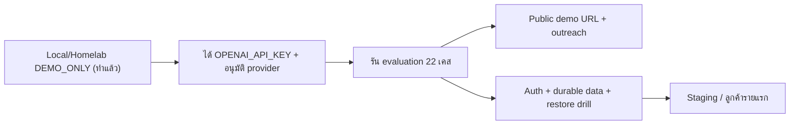

# 01 — Product Requirements (PRD)

## 1. ปัญหาและเป้าหมาย

- **ปัญหา:** ธุรกิจที่มีเอกสารมาก (สำนักงานกฎหมาย บัญชี ประกัน) ใช้เวลาค้นหาคำตอบจากนโยบาย/สัญญานาน และต้องการคำตอบภาษาไทยที่ตรวจสอบย้อนกลับได้ (`README.md`, `OUTREACH.md`)
- **คำสัญญาผลิตภัณฑ์:** ตอบคำถามไทย/อังกฤษจากชุดเอกสารที่อนุมัติ พร้อมอ้างอิง source/chunk; ถ้าหลักฐานไม่พอให้ตอบ "ไม่พบ" อย่างชัดเจน (`AI-DOC-ASSISTANT-PRODUCT-SCOPE.md`)
- **เป้าหมายภายใน:** พิสูจน์ชุด role package และ lifecycle ขององค์กรกับเคสจริงที่มีขอบเขต (`lifecycle-pack.md`) และเตรียมเดโมสำหรับงานขาย

## 2. ผู้ใช้ / Persona

| ID | Persona | งานที่ต้องทำ |
|---|---|---|
| P-OPR | Operator ภายในที่ได้รับอนุญาต | อัปโหลดเอกสารที่อนุมัติ ถามคำถาม ตรวจอ้างอิง |
| P-PLT | ผู้ดูแลแพลตฟอร์ม | deploy, ตรวจ health/readiness, rollback, ปิด upload/query เมื่อ gate ล้มเหลว |
| P-PRS | ผู้มุ่งหวังเชิงพาณิชย์ (สำนักงานกฎหมาย 10–50 คน ฯลฯ) | ชมเดโม — **ยังไม่อนุญาต** จนกว่าจะผ่าน release gate |

## 3. ขอบเขต

**In scope (pilot):** FastAPI เดิม, เอกสาร `.txt/.pdf/.docx`, คำถามไทย/อังกฤษกับ knowledge base เดียว, retrieval + generation + citation, health/readiness, ค่า cost/latency ใน response, การให้มนุษย์ตรวจคำตอบที่มีผลทางกฎหมาย/การเงิน

**Out of scope (non-goals):** เอกสารลับของลูกค้า/ข้อมูลส่วนบุคคล/production, multi-tenant หรือ SaaS สาธารณะ, การให้คำแนะนำทางกฎหมาย/ภาษี/HR/การแพทย์, การรับประกันความคงทนของข้อมูลบน Chroma ชั่วคราว, การกระทำภายนอกอัตโนมัติจากผลของโมเดล

## 4. ฟีเจอร์หลักและลำดับความสำคัญ

| ID | ฟีเจอร์ | Priority | สถานะ |
|---|---|---|---|
| F-01 | Health/readiness ที่ทำงานโดยไม่ต้องมี key | Must | ผ่าน local smoke |
| F-02 | อัปโหลดเอกสาร allow-list + จำกัดขนาด 10 MiB | Must | สร้างแล้ว, unit test ผ่าน |
| F-03 | ถาม-ตอบไทย/อังกฤษพร้อม citation | Must | สร้างแล้ว, ยังไม่ประเมินด้วย provider |
| F-04 | No-evidence fail closed (`grounded=false`) | Must | ผ่านกรณี KB ว่าง |
| F-05 | ป้องกัน prompt injection (ห่อ context เป็นข้อมูลไม่น่าเชื่อถือ) | Must | มี boundary test; ยังไม่ประเมิน |
| F-06 | หน้าแชตในตัวพร้อมแสดงแหล่งอ้างอิงและ metrics | Should | สร้างแล้ว |
| F-07 | Authentication + tenant model | Must ก่อนใช้นอกเดโม | ยังไม่มี |
| F-08 | Data store คงทน, retention/deletion, backup | Must ก่อนใช้กับลูกค้า | ยังไม่มี (staging placeholder) |
| F-09 | Multi-tenant, analytics dashboard | Could | ยังไม่มี (`README.md` Next Steps) |

## 5. ตัวชี้วัดความสำเร็จ

| ID | ตัวชี้วัด | เป้าหมาย (จาก NFR pilot) |
|---|---|---|
| M-01 | ความแม่นยำการดึง source | ≥90% บนชุดประเมินที่อนุมัติ |
| M-02 | Citation support | ≥95% ของข้อความในคำตอบอ้างถึง source ที่คืน |
| M-03 | No-evidence และ injection | 100% fail closed |
| M-04 | Latency | p95 ≤8 วินาทีต่อคำถามปกติ |
| M-05 | ต้นทุน | ≤USD 0.05 ต่อคำถามปกติ (เกณฑ์วางแผน) |
| M-06 | ผลเชิงธุรกิจ (เดโม → ลูกค้า) | **[ต้องยืนยัน]** ยังไม่มี baseline หรือเป้า |

## 6. Roadmap / Phase

วันเป้าหมายแต่ละขั้น: **[ต้องยืนยัน]**; ราคาใน `README.md` (setup ฿30K–200K, retainer ฿5K–25K/เดือน) เป็นตัวเลขชี้นำ ไม่ใช่ราคาที่อนุมัติ

## 7. ข้อสมมติฐานและความเสี่ยง

| ID | รายการ |
|---|---|
| A-01 | ใช้ OpenAI โดยตรงสำหรับ embedding และ generation **[ต้องยืนยัน]** ว่าต้องผ่าน Central AI Gateway หรือไม่ |
| A-02 | ใช้เอกสารสังเคราะห์ใน `sample-documents/` เท่านั้นจนกว่าจะผ่าน data gate |
| R-01 | ไม่มี auth — ใครเข้าถึง URL ได้ก็อัปโหลด/ถามได้ (threat T-01) |
| R-02 | ChromaDB เป็น in-memory (`chromadb.Client()`) ข้อมูลหายเมื่อ restart แม้ `render.yaml` จะต่อ disk |
| R-03 | ยังไม่มี key จริง จึงยังไม่รู้คุณภาพคำตอบจริง |
| R-04 | คำตอบอาจถูกตีความเป็นคำแนะนำทางกฎหมาย (T-10) |

## การอนุมัติ

| บทบาท | สถานะ | วันที่ | ลงนาม |
|---|---|---|---|
| Product / AI Delivery | ร่างเพื่อพิจารณา | 2026-10-07 | ________ |
| Accountable sponsor | รอพิจารณา | ________ | ________ |

## แหล่งข้อมูล

- `operations/ai/AI-DOC-ASSISTANT-PRODUCT-SCOPE.md`
- `roles/pilots/ai-doc-assistant/business-requirements.md`, `non-functional-requirements.md`, `lifecycle-pack.md`, `decision-log.md`
- `engagements/internal/solo-empire/ai-doc-assistant/README.md`, `rag_engine.py`, `render.yaml`
- `operations/ai/AI-DOC-ASSISTANT-THREAT-MODEL.md`
