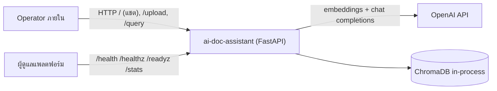
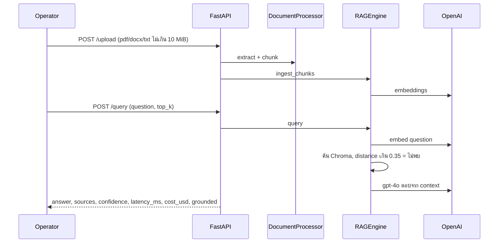
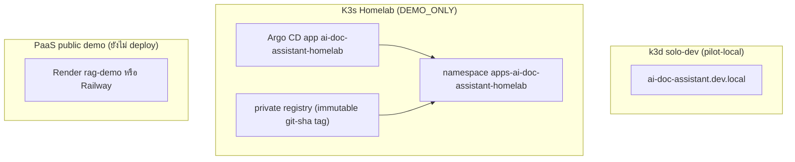

# 02 — System Architecture

## 1. Context diagram

## 2. Components

| Component | หน้าที่ | ไฟล์ |
|---|---|---|
| API + UI host | FastAPI, CORS allow-list จาก `CORS_ALLOW_ORIGINS`, เสิร์ฟ `static/index.html` ที่ `/` | `main.py` |
| Document processor | อ่าน PDF (PyPDF2), DOCX (python-docx), TXT แล้วตัด chunk ขนาด 500 อักขระ overlap 50 | `document_processor.py` |
| RAG engine | สร้าง embedding (`text-embedding-3-small`), ค้น Chroma (cosine), ตัดสิน no-evidence เมื่อ distance > 0.35, สร้างคำตอบด้วย `gpt-4o` (temperature 0.3), คำนวณ cost/latency | `rag_engine.py` |
| Prompt boundary | ห่อ context ใน `<retrieved_context>` และสั่งให้ถือเป็นข้อมูลที่ไม่น่าเชื่อถือ | `rag_engine.py` |
| OpenAI client | สร้างแบบ lazy — health/readiness ไม่ต้องใช้ key; upload/query คืน 503 ถ้าไม่มี key | `rag_engine.py`, `main.py` |

## 3. Tech stack

Python 3.11 (Docker image `python:3.11-slim`), FastAPI ≥0.115, uvicorn, ChromaDB ≥0.5, openai ≥1.50, PyPDF2, python-docx, pydantic 2, numpy <2.0; UI เป็น HTML/JS ไฟล์เดียว (`static/index.html`)

## 4. Data stores

| Store | สถานะ | หมายเหตุ |
|---|---|---|
| ChromaDB collection `knowledge_base` | in-memory (`chromadb.Client()`) | หายเมื่อ restart; disk `/app/chroma-data` ใน `render.yaml`/Dockerfile ยังไม่ถูกใช้โดยโค้ด |
| ไฟล์อัปโหลด | temp file ลบทันทีหลังประมวลผล | ไม่เก็บต้นฉบับ |
| Staging (แผน) | Postgres + pgvector หรือ Qdrant, object storage S3-compatible | placeholder, `deploymentEnabled: false` |

## 5. Integrations

- OpenAI API (embedding + chat) ผ่านตัวแปร `OPENAI_API_KEY`; ยังไม่ผ่าน Central AI Gateway **[ต้องยืนยัน]** ว่าต้องย้ายหรือไม่ (DEC-AIDOC-004: ห้ามตั้ง provider จนกว่าจะอนุมัติเงื่อนไข งบ และ reviewer)
- ไม่มีการเชื่อม CRM/อีเมล — `OUTREACH.md` เป็นร่างเท่านั้น

## 6. Deployment topology

- Helm chart กลาง `infra/platform/helm/solo-app`; probe `/healthz` (liveness/startup), `/readyz` (readiness); request 100m/256Mi, limit 1 CPU/1Gi, HPA 1–2 replicas (`infra/platform/onboarding/apps/ai-doc-assistant.yaml`)
- เป้าหมาย PaaS: `STATUS`/`DEPLOY-WHEN-KEY` ระบุ Render, `DEPLOYMENT.md` แนะนำ Railway — **[ต้องยืนยัน]** ผู้ให้บริการที่จะใช้

## 7. ADR สำคัญ

| ID | การตัดสินใจ | สถานะ |
|---|---|---|
| ADR-01 (DEC-AIDOC-001) | Chroma ชั่วคราว + เอกสารสังเคราะห์ = demo-only | อนุมัติสำหรับ local/Homelab |
| ADR-02 (DEC-AIDOC-003) | Upload allow-list, 10 MiB, temp path สุ่ม, ลบไฟล์, error จำกัดรายละเอียด, CORS จำกัด | ทำแล้วใน `815d8e7`; รอ security review |
| ADR-03 (DEC-AIDOC-004) | ไม่ตั้ง provider จนกว่าอนุมัติ | blocked |
| ADR-04 (DEC-AIDOC-006) | ปิด release สาธารณะ/ลูกค้าจนกว่าผ่านทุก gate | proposed |
| ADR-05 | Health ไม่ต้องพึ่ง provider (lazy client) | ทำแล้ว |

## การอนุมัติ

| บทบาท | สถานะ | วันที่ | ลงนาม |
|---|---|---|---|
| Solution Architect | ร่างเพื่อพิจารณา | 2026-10-07 | ________ |
| Accountable sponsor | รอพิจารณา | ________ | ________ |

## แหล่งข้อมูล

- `engagements/internal/solo-empire/ai-doc-assistant/main.py`, `rag_engine.py`, `document_processor.py`, `Dockerfile`, `render.yaml`, `railway.toml`, `DEPLOYMENT.md`, `requirements.txt`
- `infra/platform/onboarding/apps/ai-doc-assistant.yaml`, `infra/platform/gitops/applications/values/staging/ai-doc-assistant.yaml`
- `operations/ai/AI-DOC-ASSISTANT-HOMELAB-RUNBOOK.md`
- `roles/pilots/ai-doc-assistant/decision-log.md`, `architecture-decision.md`
