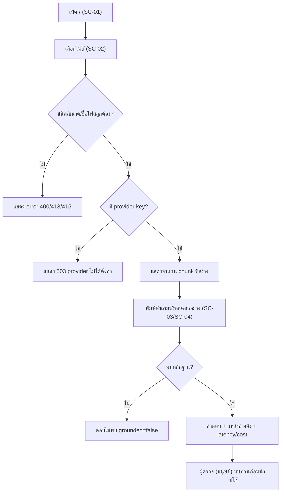

# 06 — User Flow และ Screen Inventory

## 1. รายการหน้าจอ

ระบบมีหน้า UI เดียว (`static/index.html` เสิร์ฟที่ `/`) แบ่งเป็นส่วน ๆ และหน้า Swagger ของ FastAPI

| ID | หน้าจอ/ส่วน | Element หลัก | บทบาท | สถานะ |
|---|---|---|---|---|
| SC-01 | Header + สถิติ KB | หัวเรื่อง "RAG-as-a-Service", `#stats` | Operator | สร้างแล้ว |
| SC-02 | ส่วนอัปโหลดเอกสาร | `#file-input` (accept `.pdf,.docx,.txt`), `#upload-status` | Operator | สร้างแล้ว |
| SC-03 | Welcome + คำถามตัวอย่าง | `#welcome`, ปุ่มตัวอย่าง 3 ปุ่ม (อังกฤษ 1, ไทย 2) | Operator | สร้างแล้ว |
| SC-04 | แชตถาม-ตอบ | `#chat`, `#question` (placeholder "พิมพ์คำถาม..."), ปุ่ม `#send-btn` "ถาม"; แสดงคำตอบ แหล่งอ้างอิง และ metrics | Operator | สร้างแล้ว |
| SC-05 | Swagger UI | `/docs` | ผู้ดูแล/นักพัฒนา | มีจาก FastAPI |

## 2. User flow หลัก

## 3. Design system / Component

- HTML/CSS/JS ไฟล์เดียว ไม่มี framework; UI ภาษาไทยเป็นหลักพร้อมตัวอย่างภาษาอังกฤษ
- Safety ของ UI: คำถาม คำตอบ metadata ของ citation และ error ถูก render เป็น text (กัน XSS) และกันการกดส่งซ้ำ — ตรวจด้วย `test_ui_safety.cjs`
- รองรับ mobile ผ่าน `enterkeyhint="send"` ในช่องคำถาม; การออกแบบ responsive โดยละเอียด **[ต้องยืนยัน]**
- `README.md` เคยวางแผน Next.js chat UI แต่เลือกใช้ inline HTML แทน
- ยังไม่มีหน้าจอ login, จัดการเอกสาร (ลบ/ดูรายการ) หรือ dashboard analytics

## การอนุมัติ

| บทบาท | สถานะ | วันที่ | ลงนาม |
|---|---|---|---|
| UX/UI (AI Product Delivery) | ร่างเพื่อพิจารณา | 2026-10-07 | ________ |
| Product owner | รอพิจารณา | ________ | ________ |

## แหล่งข้อมูล

- `engagements/internal/solo-empire/ai-doc-assistant/static/index.html`, `main.py`, `README.md`, `test_ui_safety.cjs`
- `roles/pilots/ai-doc-assistant/research-and-design-handoff.md`
